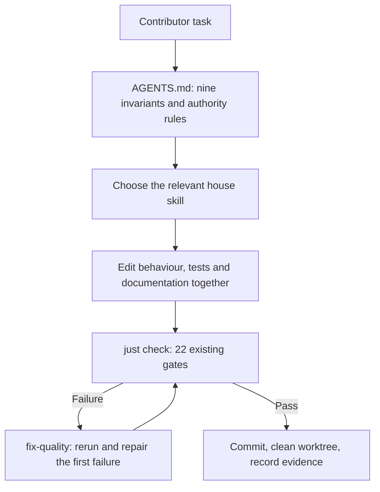
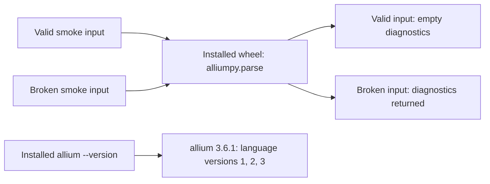

[T05 ticket](https://github.com/BiscuitBin/alliumpy/blob/ticket/T05-agent-contract/tickets/T05-agent-contract.md)

## Why the change

Replace T00's agent-instruction stubs with a complete contract and seven task workflows so contributors can make packaging changes with consistent authority boundaries and verification evidence.

## Special things to note

- This changes contributor instructions; Rust/Python runtime code, check recipes, adapters, bridges and skill frontmatter are unchanged.
- Review found that the frozen version checker does not inspect either crate manifest; the ticket records a T00 follow-up and stronger evidence for an inherited verification-pipeline gap.
- Full command parity is future T13 work; release automation and the upstream-bump runbook remain future T14/T17 work.

## Change outline

The documented contributor workflow now connects each task to its checks and failure recovery.



```text
AGENTS.md                          nine invariants + seven task triggers
.agents/skills/
├── plan-change/SKILL.md            scope and upstream behaviour
├── rust-change/SKILL.md            bindings → core dependency and Rust evidence
├── python-change/SKILL.md          stub + binding + pytest together
├── review-change/SKILL.md          nine-invariant review checklist
├── review-docs/SKILL.md            documentation ownership and reachability
├── fix-quality/SKILL.md            repair route for every configured gate
└── project-check/SKILL.md          prerequisites, gate order and green hand-back
tickets/T05-agent-contract.md       completed ticket, review and commit-linked evidence
```

The existing installed-wheel smoke verifies these runtime outcomes; this branch adds instructions for preserving them.



Local validation at `877b6e4`: all 22 gates pass, six core tests and five pytest cases pass, core line coverage is 100%, stubtest passes, and the release wheel installs and runs in a fresh environment offline; the worktree is clean.

Independent conformance and breakage reviews produced two in-scope fixes: correct wording for the absent T17 runbook and a snapshot repair route that generates a candidate diff before review.
